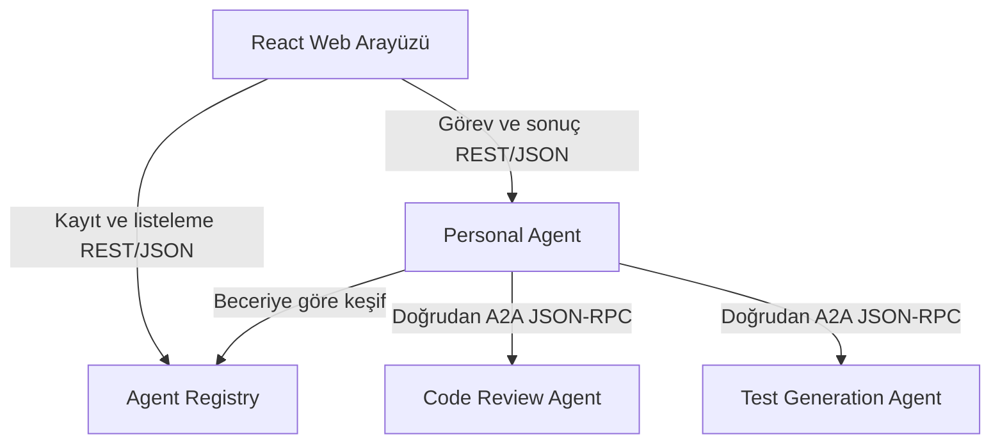

# Internet for Agents

**Mini Internet of Agents — SOA tabanlı Agent Discovery & Collaboration Platform**

Bağımsız geliştirilen uzman agent'ların ortak bir dizinde bulunabildiği ve A2A üzerinden görev alışverişi yapabildiği kontrollü bir agent ağı.

## Ne geliştiriyoruz?

Geliştirici kendi agent'ını çalıştırır ve Agent Card adresini Registry'ye kaydeder. Personal Agent kullanıcının görevine uygun uzmanları keşfeder, doğrudan A2A ile görev gönderir ve sonuçları birleştirir.

Birincil kullanıcılar agent geliştiricileri ve yazılım ekipleridir. Web arayüzü görev gönderimini, agent kaydını ve keşif/yürütme sürecini görünür yapan demo yüzüdür.

Registry görevleri taşımaz veya yürütmez. Uzmanlar ayrı uygulamalardır; veri tabanlarını paylaşmazlar.

## İlk demo

1. Code Review Agent A kaydedilir; kullanıcı Python kodunu inceletir.
2. Test Generation Agent eklenir; inceleme ve test önerisi birlikte istenir.
3. Aynı inceleme becerisini sunan Code Review Agent B eklenir; istemci kodu değişmeden keşfedilir.
4. A durdurulur; sonraki görevde uygun B seçilir. Alternatif yoksa açık hata gösterilir.

Gönderilen kod ve üretilen testler çalıştırılmaz. İlk davranış deterministik kurallarla gösterilebilir; arayüz bunu açıkça belirtir. LLM desteği opsiyonel sonraki aşamadır.

## Teknoloji kararları

| Parça | Seçim |
| --- | --- |
| Registry, Personal Agent, uzman servisler | Node.js 24 LTS, Express 5, TypeScript strict |
| Agent iletişimi | A2A 1.0, JSON-RPC 2.0 üzerinden HTTP(S) + SSE, resmi JS SDK |
| Platform API'leri | REST + JSON |
| Kalıcı veri | Servis başına ayrı SQLite dosyası |
| Web arayüzü | React + Vite |
| Yerel çalıştırma | Docker Compose; bağımsız servisler |

A2A wire JSON alanları seçilen 1.0 sürümüne göre tanımlanmıştır. SDK'nın paket sürümü protokol sürümü değildir; gerçek uyum ve paket sabitleme ilk uygulama kapısıdır.

## Durum

12 Ekim 2026: Yeni mimari, protokol örnekleri, süreçler ve yol haritası dokümante edildi. **Yeni sistem henüz uygulanmadı.** Repodaki uygulama dosyaları eski seyahat prototipidir; package.json bu tasarımı henüz yansıtmaz. Buradaki komut/endpoint/örnekler çalışan servis iddiası taşımaz.

Kod yazılması ayrı kullanıcı talimatı bekler. Çalışma dalı `oguzhan`. Bu revizyonda yalnızca dokümanlar değişmiştir.

## Belgeler

- [Okuma sırası ve tüm belgeler](docs/README.md)
- [Sistem sınırları ve alt mimariler](docs/architecture/overview.md)
- [A2A, JSON, Agent Card ve mesaj örnekleri](docs/architecture/a2a-protocol.md)
- [Uçtan uca süreçler](docs/architecture/pipelines.md)
- [Yol haritası](docs/planning/roadmap.md)
- [Karar kayıtları](docs/decisions/README.md)

## İddianın sınırı

Yeni agent, desteklenen beceri profiline ve A2A iletişim biçimine uyuyorsa özel istemci entegrasyonu gerektirmeden kullanılabilir. Bilinmeyen bir beceriyi kendiliğinden öğrenme, açık web tarama, marketplace, ödeme veya NANDA entegrasyonu ilk sürümde yoktur. NANDA aynı keşif ve birlikte çalışabilirlik problem alanında bir referanstır; bu proje onun küçük ölçekli bir uygulama denemesidir, eşdeğeri değildir.

Görev ilerlemesi ve arayüz güncellemeleri SSE ile iletilir; periyodik polling kullanılmaz. [Karar ve toparlanma akışı](docs/decisions/0023-sse-no-polling.md).
