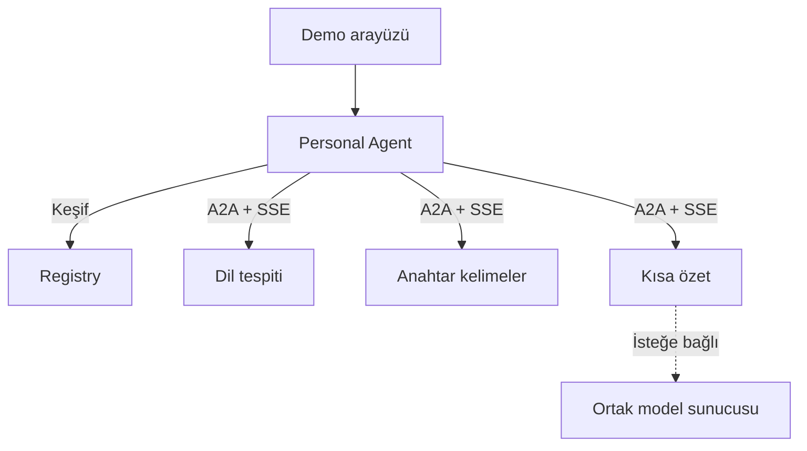

# Internet for Agents

**Mini Internet of Agents — SOA tabanlı Agent Discovery & Collaboration Platform**

Bağımsız geliştirilen uzman agent'ların ortak bir dizinde bulunabildiği ve A2A üzerinden görev alışverişi yapabildiği kontrollü bir agent ağı.

## Ne geliştiriyoruz?

Geliştirici kendi agent'ını çalıştırır ve Agent Card adresini Registry'ye kaydeder. Personal Agent kullanıcının görevine uygun uzmanları keşfeder, doğrudan A2A ile görev gönderir ve sonuçları birleştirir.

Birincil kullanıcılar agent geliştiricileri ve yazılım ekipleridir. Web arayüzü görev gönderimini, agent kaydını ve keşif/yürütme sürecini görünür yapan demo yüzüdür.

## İlk demo

Kullanıcı metin verir. Personal Agent dil, anahtar kelime ve özet sağlayıcılarını dizinden keşfeder, doğrudan çağırır ve sonuçları birleştirir. Yeni bir uyumlu sağlayıcı, Personal Agent kodu değişmeden seçilebilmelidir.

Uzmanlar dar görevler üstlenir. Dil tespiti ve anahtar kelimeler deterministik olabilir; özetleme geliştirmede fixture kullanabilir. Fixture gerçek analiz olarak sunulmaz. Model zorunlu değildir.

## Teknoloji kararları

| Parça | Seçim |
| --- | --- |
| Registry, Personal Agent, uzman servisler | Node.js 24 LTS, Express 5, TypeScript strict |
| Agent iletişimi | A2A 1.0, JSON-RPC 2.0 üzerinden HTTP(S) + SSE, resmi JS SDK |
| Platform API'leri | REST + JSON |
| Kalıcı veri | Servis başına ayrı SQLite dosyası |
| Web arayüzü | React + Vite |
| Yerel çalıştırma | Docker Compose; bağımsız servisler |

A2A wire JSON alanları seçilen 1.0 sürümüne göre tanımlanmıştır. SDK'nın paket sürümü protokol sürümü değildir; gerçek uyum ve paket sabitleme ilk uygulama kapısıdır.

## Durum

13 Ekim 2026: N01 A2A/SSE denemesi tamamlandı. Yeni TypeScript servis iskeleti ve Docker profilleri eklendi. **Ürün akışı henüz tamamlanmadı:** Registry kayıt/keşfi ve uzmanların A2A/SSE yürütmesi eklendi. Registry kayıtları SQLite’ta saklanır; Personal Agent keşif, paralel A2A çağrısı ve sonuç SSE’si eklendi. Dil tespiti ve anahtar kelime çıkarma deterministik algoritmalarla çalışır; özet fixture’dır. Personal ve uzman görevleri SQLite’ta saklanır. React demo arayüzü eklendi; gerçek özetleme sonraki aşamadır. Çalışma dalı `oguzhan`.

- [Demo arayüzünü çalıştırma](docs/development/demo-ui.md)
- [Görev kalıcılığı ve test sonuçları](docs/development/persistence.md)
- [Hafif metin algoritmaları ve sınırları](docs/development/text-algorithms.md)
- [Personal Agent akışı ve örnek görev](docs/development/personal-agent.md)
- [Registry/A2A çalıştırma akışı](docs/development/registry-a2a.md)
- [Metin kontratları](docs/architecture/text-profiles.md)
- [Docker ve ekip geliştirme rehberi](docs/development/local.md)
- [Metin agent’ları ve kaynak kullanımı kararı](docs/decisions/0024-local-text-agents.md)
- [N01 sonuç raporu](docs/planning/n01-results.md)

Eski seyahat prototipi kökte korunur ve `npm start` ile açılır. Yeni servis için `npm run dev:service` kullanılır.

## Belgeler

- [Okuma sırası ve tüm belgeler](docs/README.md)
- [Sistem sınırları ve alt mimariler](docs/architecture/overview.md)
- [A2A, JSON, Agent Card ve mesaj örnekleri](docs/architecture/a2a-protocol.md)
- [Uçtan uca süreçler](docs/architecture/pipelines.md)
- [Yol haritası](docs/planning/roadmap.md)
- [Karar kayıtları](docs/decisions/README.md)

## İddianın sınırı

Yeni agent, desteklenen beceri profiline ve A2A iletişim biçimine uyuyorsa özel istemci entegrasyonu gerektirmeden kullanılabilir. Bilinmeyen bir beceriyi kendiliğinden öğrenme, açık web tarama, marketplace, ödeme veya NANDA entegrasyonu ilk sürümde yoktur. NANDA aynı keşif ve birlikte çalışabilirlik problem alanında bir referanstır; bu proje onun küçük ölçekli bir uygulama denemesidir, eşdeğeri değildir.

Görev ilerlemesi ve arayüz güncellemeleri SSE ile iletilir; periyodik polling kullanılmaz. [Karar ve toparlanma akışı](docs/decisions/0023-sse-no-polling.md).
