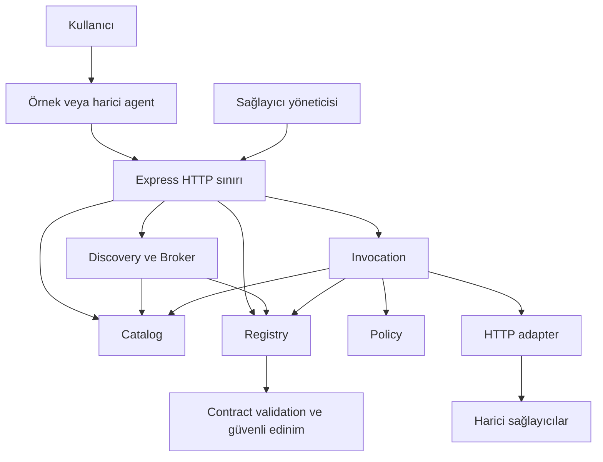

# Sistem bağlamı ve servis sınırları

Durum: MVP için kararlaştırıldı. [Kararlar](../decisions/README.md).

## Bağlam

## Mantıksal servisler

| Servis | Sahip olduğu bilgi | Sorumluluk |
| --- | --- | --- |
| Catalog | Değişmez yetenek sürümleri | Ortak iş anlamı ve şemalar |
| Registry | Sağlayıcılar, kontrat sürümleri, durum ve doğrulama kayıtları | Kayıt, güncelleme, askı ve kaldırma |
| Discovery/Broker | Kalıcı alan verisi yok | Katalog ve Registry üzerinden uygun adayları bulma, filtreleme ve sıralama |
| Invocation | Çağrı durumu ve istemci tekrar anahtarları | Yetki, süre bütçesi, adapter çağrısı ve sonuç doğrulama |
| Policy | Konfigürasyon ve principal kapsamları | Kaynak erişimi ve outbound hedef izinleri |
| Evidence | Audit ve ölçüm kayıtları | İzlenebilirlik; sıralama için salt okunur ölçüm görünümü |

Contract validation, HTTP adapter ve ağ politikası altyapı bileşenleridir; her biri ayrı deploy edilen servis değildir. Tek Node süreci ve tek PostgreSQL ile başlanır. Mantıksal servisler yalnızca yayımladıkları uygulama arayüzleri üzerinden konuşur; birbirlerinin tablolarına yazmaz.

## Agent sınırı

Hedef yorumlama, gerekli yeteneklerin seçimi, kullanıcı etkileşimi, çok adımlı iş planı ve son alternatiflerin kullanıcıya sunulması agent'ın sorumluluğudur. Çekirdek tek çağrıyı yürütür; kendiliğinden başka sağlayıcı seçip çağırmaz. Agent farklı sağlayıcıyı çağırmak isterse yeni istek yapar.

## Bağımlılık ilkesi

HTTP controller → uygulama kullanım durumu → alan modeli ve portlar. Altyapı adapter'ları portları uygular. Alan modeli Express veya SQL istemcisini import etmez. Modüller arası bağımlılıklar açık arayüzlerden geçer; döngü kurulmaz. Telemetri portu her modülde kullanılabilir ancak iş kararının sahibi olamaz.

## Senaryolar

Kayıt: Yetkili sağlayıcı → Registry → güvenli kontrat edinimi → Catalog uyum kontrolü → aktif sürüm.

Keşif: Agent → capability/version ve kısıtlar → Registry aktif görünümü → Broker → alternatifler.

Çağrı: Agent seçimi → Registry sürüm ve durum kontrolü → Policy → Invocation → Adapter → çıktı doğrulama → sonuç.

## Kod sınırı

Bu set yalnızca dokümantasyondur. Uygulama kodu kullanıcının ayrı başlatma talimatıyla yazılır.
