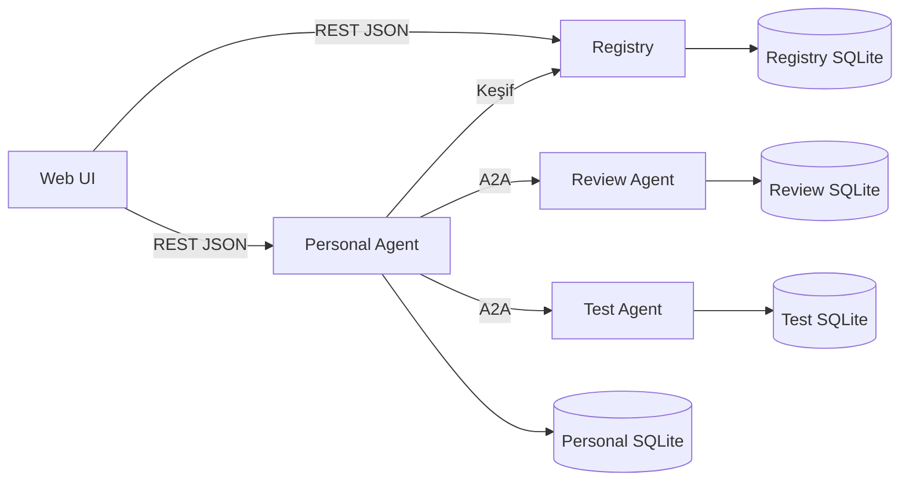

# Sistem ve alt mimariler

## Dört mimari düzey

| Düzey | Karar | Neden |
| --- | --- | --- |
| Sistem | SOA; dört backend servisi ve web UI | Bağımsız servis sahipliği ve çalıştırma |
| Servis içi | Hafif hexagonal/katmanlı yapı | Framework, DB ve LLM bağımlılıklarını iş akışından ayırma |
| Entegrasyon | Registry için REST; agent'lar için A2A JSON-RPC | Keşif ile görev trafiğinin ayrılması |
| Çalıştırma | Compose, servis başına bir instance ve ayrı SQLite | Ders kapsamına uygun işletim |

## Mantıksal görünüm

SOA servis başına repository gerektirmez. Monorepo içinde ayrı deployment hedefleri vardır. Registry bir gateway değildir; A2A görevleri üzerinden geçmez.

## Servis içi bağımlılık

Presentation → Application → Domain. Infrastructure, application/domain tarafından tanımlı portları uygular. Composition root bunları bağlar. Domain Express, A2A SDK, SQLite veya LLM SDK import etmez.

- Presentation: REST controller, A2A handler, doğrulama ve DTO mapping.
- Application: register/search/create job/dispatch/check status gibi kullanım durumları.
- Domain: kayıt durumu, görev planı, seçim kuralları, sonuç ve profil invariant'ları.
- Infrastructure: SQLite repository, Registry HTTP client, A2A SDK adapter, clock, analyzer/LLM adapter.

Küçük servislerde katmanlar birer klasör olabilir; her sınıf için gereksiz interface üretilmez. Portlar DB, ağ, saat ve analiz motoru gibi değişebilen sınırlar içindir.

## Personal Agent alt yapısı

Request Interpreter → Plan Builder → Discovery Client → Selector → A2A Dispatcher → Task Tracker → Result Aggregator.

Bunlar aynı uygulamanın modülleridir. İlk planlar sabittir: review, tests, review+tests. Sonuncusu iki bağımsız child task paralel yürütür. Genel workflow/DAG motoru veya merkezi message broker yoktur.

## Uzman alt yapısı

A2A transport adapter → Profile Validator → Task Application Service → AnalysisEngine port → Artifact Builder → Task Repository.

A2A iletişim tipleri boundary'de iç modele dönüştürülür. Domain'de yalnızca Python kaynak metni ve typed sonuçlar görülür. Kural motorundan LLM'e geçmek engine adapter değişikliğidir, A2A protokolünü değiştirmez.

## Bağımsızlık kuralları

Başka servisin DB'sine, source modülüne veya domain nesnesine doğrudan erişilmez. Ortak paket yalnızca profile DTO/schema, teknik gözlem yardımcıları ve A2A adapter yardımcıları içerebilir. Registry uygulama mantığı uzmanlara import edilmez. Shared package dağıtık servisleri lockstep deploy zorunluluğuna sokmamalı; profile version açık taşınır.
