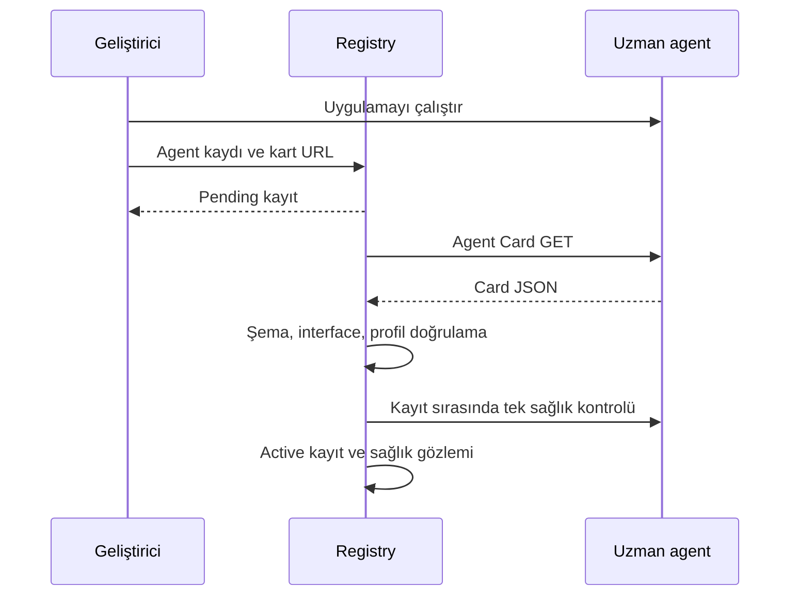
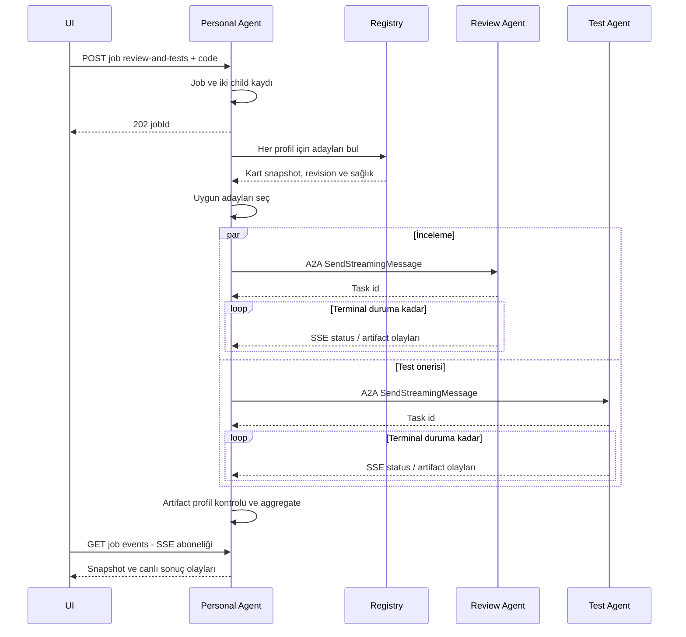

# Uçtan uca süreçler

## P1 — Agent yayımlama ve kayıt

Geliştirici uzman uygulamasını başlatır → Agent Card yayımlar → Registry'ye cardUrl/profil eşleştirmesi gönderir → kart edinilir ve doğrulanır → snapshot aktifleşir → readiness gözlemi alınır → agent keşfedilebilir olur.

Registry doğrulama işi SQLite pending kaydından süreç içi worker ile alınır. En fazla 3 edinim denemesi; yanlış şema kalıcı reddir. Restart pending işi devam ettirir. Çalışır uygulama kodu yoktur; diyagram hedef akıştır.

## P2 — Kullanıcı görevi

Kullanıcının browser bağlantısı iş yürütmesini sahiplenmez. UI kapanınca job yürümeye devam eder. Orchestrator Personal Agent içindedir; ayrı SOA servisi değildir. Review sonucu ilk MVP'de Test Agent'a girdi yapılmaz; her iki child aynı orijinal kodu alır. Sıralı review→test pipeline sonraki aşamadır.

## P3 — Yeni sağlayıcı

Review A aktifken aynı profile uyan B kaydedilir. Yeni discovery sonucu A/B içerir; kullanıcı alternatifleri görür. A durdurulup unhealthy gözlemlenince yeni job B'yi seçer. Personal Agent kaynak dosyası değiştirilmez. Yeni test becerisi eklemek ile mevcut review sağlayıcısını değiştirmek ayrı demo adımlarıdır.

## P4 — Hata ve takip

SendStreamingMessage ilk task olayı alınmadan timeout → dispatch sonucu belirsiz → aynı child/requestId/messageId ile yalnız profil dedup garantili uzmanlarda kontrollü uzlaştırma. Task id alındıysa yeni görev gönderilmez; SubscribeToTask ile SSE yeniden açılır. Terminal görev aboneliği reddedilirse tek GetTask ile sonuç uzlaştırılır. Alternatif uzmana otomatik geçiş ancak gönderimin kesin başlamadığı pre-dispatch hatada bir kez mümkündür. Belirsiz durumda UI sonucu açıkça gösterir.

## P5 — Geliştirme pipeline'ı

Protokol uyum spike → workspace iskeleti → ilk uzman → Registry → Personal Agent → ikinci uzman ve aggregator → UI → failure demo → kabul raporu. Her aşama bir öncekinin somut çıktısını kullanır; ayrıntı [roadmap](../planning/roadmap.md).
