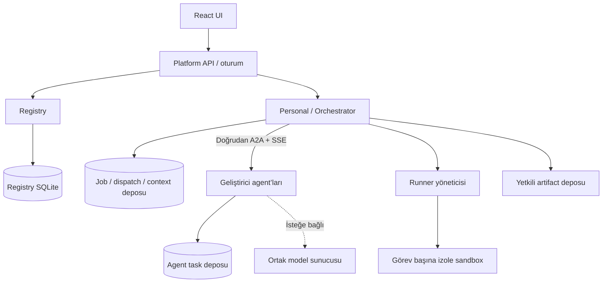

# Sistem, alt mimariler ve yürütme

## SOA sınırları

Platform API başlangıçta Personal process’i içindeki sunum/BFF modülüdür; ayrı dağıtım zorunlu değildir. Registry görev verisini taşımaz. Runner ayrı güven sınırıdır; web/API process’i içinde eval/subprocess yoktur. Artifact deposu önce dosya + metadata adaptörü olabilir; farklı agent’lar doğrudan birbirinin diskini okuyamaz.

| Sorumlu | Sahip olduğu veri | Başkasına bırakacağı iş |
| --- | --- | --- |
| Registry | Owner, kart/manifest snapshot’ı, revision, kayıt durumu | Görev yürütme, model seçimi |
| Orchestrator | Plan, step, dispatch, kullanıcı işi, context bağları | Uzmanın iç algoritması |
| Agent | Kendi task/artifact durumu, model çağrısı | Platform kullanıcı yetkisini devralmak |
| Runner | Execution ID, sınırlar, exit/test raporu | Kod üretme veya test sonucu uydurma |
| Web | Form taslağı ve gösterim durumu | Yetki kararı veya sağlayıcı seçim kuralı |

## Servis içi mimari

Presentation → Application → Domain; Infrastructure portları uygular. Domain Express, A2A, SQLite veya LLM SDK import etmez. Ortak paket taşıma/şema yardımcıları içerir; Registry iş mantığı uzmanlara import edilmez. Değişebilir sınırlar için repository, clock, model, network ve runner portları yeterlidir; her fonksiyona interface eklenmez.

## Kontrol ve veri akışı

Kayıt/keşif REST JSON’dur. Agent görevleri A2A 1.0 JSONRPC + SSE’dir. UI olayları ayrı SSE akışıdır; heartbeat durum sorgusu değildir. Başlangıçta merkezi message broker yoktur. Kalıcı dispatch kaydı ve iş sahipliği tek-instance SQLite üzerinde tutulur; çoklu worker’a geçiş lease/transaction tasarımı gerektirir.

Job ve step ayrı durum makineleridir. Step: pending → ready → dispatching → running → completed/failed/canceled/unknown. input-required/auth-required kullanıcı müdahalesi bekleyen ayrı durumlardır; genel schema desteklese de code-demo v1 bu durumları üretmez. Unknown terminal başarı değildir; kurtarma kararı gerektirir.

Kullanıcı job sonucu: tüm gerekli adımlar başarılıysa completed; kullanılabilir alt sonuç varsa partial; hiç sonuç yok ve belirsiz adım varsa unknown; diğer durumda failed. Downstream gerekli input yoksa çalıştırılmaz, blocked_dependency olarak raporlanır. İsteğe bağlı adımlar akış tanımında önceden belirtilir.

## Deklaratif workflow

Her adım: stepId, capability/profile sürümü, gerekli yetki, input mapping, budget, required flag ve çıktı tanımı taşır. Alan eşlemeleri JSON Pointer benzeri sınırlı referanslardır; eval/JS ifadesi yoktur. Plan kaydedilmeden döngü, eksik kaynak, uyumsuz sürüm ve yetkisiz adım kontrol edilir. Tip uyumu semantik uyum kanıtı değildir; workflow yazarı anlamı onaylar.

Sağlayıcı seçimi: görünür/izinli → profil uyumlu → bütçeye uygun → açıklanabilir sıralama. İlk sıra deterministik olabilir; gecikme/başarı puanı yeterli gözlem yokken uydurulmaz. Kartta beyan edilen QoS gözlenen QoS’tan ayrılır. Yeni sağlayıcı endpoint’i workflow’a sabitlenmez.

## Context/memory

| Veri | Sahiplik ve ömür | Aktarım |
| --- | --- | --- |
| Görev checkpoint’i | Orchestrator, terminalden sonra 7 gün varsayılan | Yalnız yetkili kullanıcı/worker |
| Çalışma context’i | Job/step kapsamı | Yalnız mapped alanlar |
| Kod/test/review artifact’i | User/job/step/source sürümü; 7 gün varsayılan | Scoped artifact erişimi veya boyutu sınırlı inline |
| Kullanıcı tercihi | Açık kaydetme/silme | Gereken adımlara minimum alan |
| Agent özel belleği | Geliştirici sorumluluğu | Varsayılan platform paylaşımı yok |

Context envelope: jobId, stepId, input artifact ID/hash/sürümü, kaynak step, görünürlük ve boyut bütçesi. Gizli model muhakemesi toplanmaz; kısa karar gerekçesi, araç işlemi ve ölçülebilir durum kaydedilir. Büyük context sessizce kesilmez; bütçe hatası veya kaynak referanslı özet kullanılır. Özet asıl artifact’in yerine tek doğru kaynak yapılmaz. Vektör DB ve görevler arası kişisel memory Teslim B’ye bırakılır.

Idempotency retention 24 saat, job/artifact retention 7 gün; silinen iş için anahtar 24 saat dolana kadar tombstone ile korunur ve 410 döner. Silme aktif işi önce durdurma/uzlaştırma politikasından geçer. Backup’taki silme gecikmesi en fazla 30 gün olarak açıklanır; açık silme politikası olmadan kullanıcıya anında tüm kopyaların yok olduğu söylenmez.

## Hata ve toparlanma

Gönderimden önce dispatch ve dedup anahtarı kalıcılaştırılır. Agent aynı caller+key+payload için aynı task döndürür, farklı payload 409 eşdeğeri çatışma verir. Tam exactly-once garantisi iddia edilmez; test edilen sınırlar ve desteklenen agent dedup davranışı raporlanır.

SSE kopunca bütçe içinde en fazla iki yeniden abonelik (0.5/1 saniye ve jitter); aynı taskId kullanılır. Terminal abonelik reddinde tek snapshot. Sürekli GET yoktur. Gönderim sonrası taskId bilinmiyorsa ve sağlayıcı dedup desteklemiyorsa otomatik failover yapılmaz. Timeout yerel beklemeyi bitirir; uzak iptal teyidi yoksa canceled denmez.

## Dağıtım ve ölçek yolu

Teslim A: Node 24, Express 5, TypeScript, React/Vite, Compose; her servisin ayrı volume’ı ve tek instance’ı. Önce ölçüm, sonra darboğaz giderme. Çoklu instance öncesi normalleştirilmiş job/dispatch tabloları, PostgreSQL veya eşdeğer concurrency deposu, shared artifact erişimi, lease ve SSE fan-out gerekir. Bunlar güncel uygulamada mevcut değildir.
